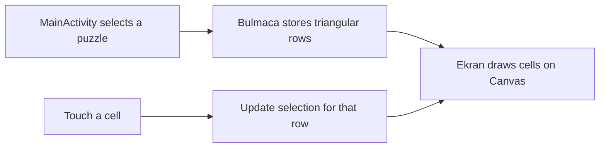

# PiramitOyunu

A small Android number puzzle written in Java in 2022. Choose one digit per row from the top of a pyramid to the bottom. The intended challenge is to pick distinct digits. Touching a different cell replaces the current selection in that row.

## How it works

The board is stored as rows of increasing length. A short digit string defines each puzzle, so the app can ship its examples offline. The custom view computes cell bounds from screen width and uses the same geometry for drawing and hit testing.

## Run locally

Open the repository in Android Studio with Android SDK 32 installed. Run the app on an emulator or device using API 25 or later. To build from the command line, use `./gradlew assembleDebug` (Windows: `gradlew.bat assembleDebug`).

## Checks and limitations

Tap a cell and then another cell in the same row. Only the new cell should be highlighted. The repository contains Android template tests; they do not cover the puzzle rules. The view tracks selections but does not enforce a winning route or persist a game across activity recreation.